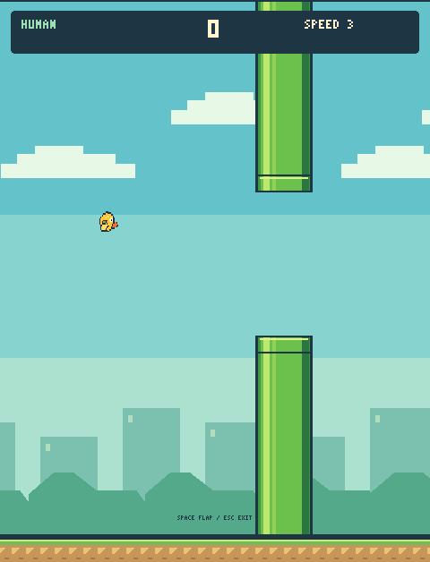
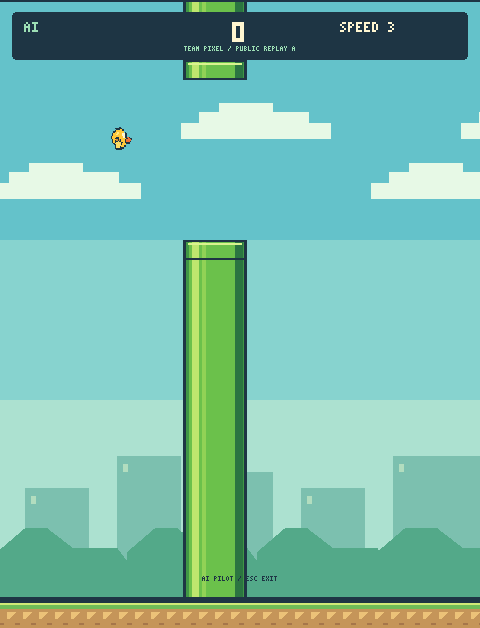

# Arcade display

Original offline sprites and bitmap text. Use existing play/demo/watch commands.
Set FLAPPY_SCALE=2 for crisp integer scaling or FLAPPY_FULLSCREEN=1 for
letterboxed fullscreen. The 480x600 world is unchanged; a decorative 28-pixel
floor is drawn below it. Native output is 480x628; 2x output is 960x1256.
No physics, collision, agent, reward or competition rules changed.
Ready/final cards follow existing command behavior; rerun to restart.

135 tests pass. Frozen Q-table trajectories and scores match the previous
renderer on ten fixed seeds. SDL dummy rendering exceeds 3000 frames/s;
physical monitor, Windows/Linux and projector performance were not measured.

Human play opens on START. Press ENTER or SPACE to begin; physics remains
paused while the menu is visible. SPACE flaps and ESC exits.

Q-table watch has a clickable PLAYBACK button below the game. Click to cycle
1x, 2x, 4x, 8x and back to 1x. This changes pacing only, not game physics.
